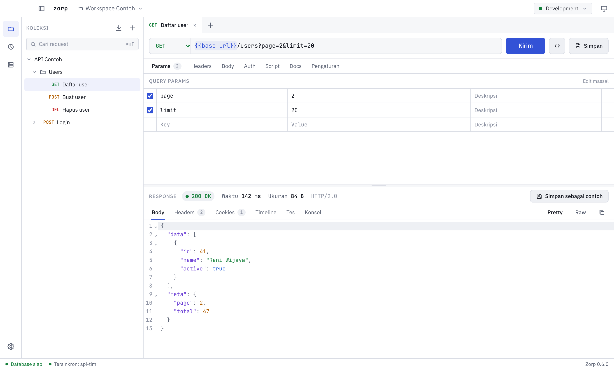

<p align="center">
  
</p>

<h1 align="center">Zorp</h1>

<p align="center">Klien API desktop yang ringan untuk menyusun, mengirim, dan menguji request HTTP.</p>

<p align="center">
  <picture>
    <source media="(prefers-color-scheme: dark)" srcset="docs/screenshot-dark.png">
    
  </picture>
</p>

## Fitur

- **Request HTTP**: semua method umum, query params yang tersinkron dengan URL, header, body JSON, raw, form-urlencoded, form-data, dan binary.
- **Koleksi**: folder bertingkat, drag-and-drop, multi-tab, dan riwayat request.
- **Environment**: variabel `{{nama}}` dengan penanda variabel yang tidak ditemukan. Nilai rahasia disimpan di keychain sistem.
- **Auth**: Bearer, Basic, API key, dan OAuth 2.0 (Authorization Code dengan PKCE, Client Credentials, refresh otomatis). Auth bisa diwariskan dari folder atau koleksi.
- **Script**: pre-request dan test script dengan API mirip Postman (`pm.environment`, `pm.test`, `pm.expect`, dan lainnya).
- **Collection runner**: menjalankan seluruh koleksi atau folder secara berurutan beserta ringkasan tes.
- **Impor dan ekspor**: koleksi Postman v2.1, perintah cURL, serta code snippet untuk cURL, fetch, axios, Python, dan Go.
- **Jaringan**: cookie jar per workspace, rincian waktu (DNS, koneksi, tunggu server, unduh), proxy HTTP/HTTPS/SOCKS5, sertifikat CA kustom, dan sertifikat klien (mTLS).
- **Command palette** (`⌘K` / `Ctrl K`) untuk mencari request dan menjalankan aksi.

## Instalasi

Unduh installer untuk sistem operasi Anda dari halaman [Releases](https://github.com/est57/Zorp/releases).

| Sistem | File |
|---|---|
| macOS (Apple Silicon) | `Zorp_<versi>_aarch64.dmg` |
| macOS (Intel) | `Zorp_<versi>_x64.dmg` |
| Windows | `Zorp_<versi>_x64-setup.exe` atau `.msi` |
| Linux | `.AppImage`, `.deb`, atau `.rpm` |

Installer saat ini belum ditandatangani (unsigned), sehingga sistem operasi akan menampilkan peringatan saat pertama kali dibuka.

- **macOS**: buka Zorp sekali, lalu buka **System Settings > Privacy & Security** dan klik **Open Anyway**. Cara lain lewat Terminal:
  ```bash
  xattr -dr com.apple.quarantine /Applications/Zorp.app
  ```
- **Windows**: pada layar SmartScreen, klik **More info**, lalu **Run anyway**.
- **Linux (AppImage)**: jadikan file dapat dieksekusi dengan `chmod +x Zorp*.AppImage` (atau `zorp*.AppImage`, sesuai nama file yang diunduh).

## Pengembangan

Kebutuhan:

- Node.js 22 dan pnpm
- Rust stable
- Dependensi sistem Tauri 2 sesuai [panduan resmi](https://tauri.app/start/prerequisites/). Di Linux: `libwebkit2gtk-4.1-dev`, `libappindicator3-dev`, `librsvg2-dev`, dan `patchelf`.

```bash
pnpm install
pnpm tauri dev
```

UI juga bisa dibuka di browser biasa dengan data contoh, tanpa backend, melalui `http://localhost:1420/?mock` saat `pnpm dev` berjalan. Mode ini hanya tersedia saat pengembangan.

Pemeriksaan yang juga dijalankan oleh CI:

```bash
pnpm lint && pnpm format:check && pnpm typecheck && pnpm test
```

```bash
cd src-tauri && cargo fmt --check && cargo clippy --all-targets -- -D warnings && cargo test
```

Tipe TypeScript di `src/bindings` dibuat otomatis dari struct Rust saat `cargo test` dijalankan. Jangan diedit manual.

### Struktur proyek

```
src/                 Frontend Vue 3 + TypeScript
  api/               Wrapper perintah Tauri
  components/        Komponen UI per area (request, response, sidebar, runner, settings)
  stores/            State Pinia
  utils/             Parser cURL, generator snippet, util URL
src-tauri/           Backend Rust
  src/commands/      Perintah IPC
  src/pipeline/      Alur kirim: pre-request script, kirim, test script
  src/services/      Mesin HTTP, resolver variabel, OAuth, script, cookie, jaringan
  src/db/            Penyimpanan SQLite dan migrasi
```

## Keamanan

- Semua request jaringan dijalankan oleh backend Rust, bukan oleh webview.
- Nilai rahasia (variabel secret, token OAuth, password proxy) disimpan di keychain sistem dan tidak pernah ditulis ke database.
- Script berjalan di runtime QuickJS yang terisolasi, tanpa akses file, jaringan, atau sistem, dengan batas waktu 5 detik dan memori 64 MB.
- Webview memakai Content Security Policy yang ketat dan permission Tauri yang minimal.

## Rilis

1. Samakan versi di `package.json`, `src-tauri/Cargo.toml`, dan `src-tauri/tauri.conf.json`.
2. Buat tag dengan format `v<versi>`, lalu push:
   ```bash
   git tag v0.1.0 && git push origin v0.1.0
   ```
3. Workflow **Release** akan membuat installer untuk macOS, Windows, dan Linux sebagai draft release. Periksa draft tersebut, lalu terbitkan.

## Lisensi

Zorp dirilis di bawah [lisensi MIT](LICENSE).
